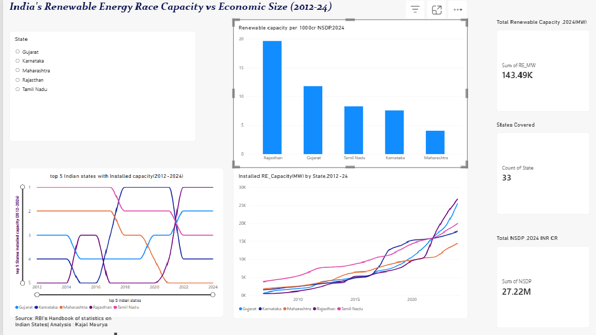

# India's Renewable Energy Race: Capacity vs Economic Size (2012-2024)

Why do some Indian states install far more renewable energy than others? This project compares **state-level renewable energy (RE) capacity** with **state economic size (NSDP)** from 2012 to 2024, and looks at how policy and geography help explain the gaps.

**Author:** Kajal Maurya
**Tools:** Excel (cleaning) · Python / Google Colab (regression) · SQLite / DB Browser (queries) · Power BI (dashboard)

---

## Research question

What explains the differences in renewable energy adoption across Indian states: economic size, electricity demand, state policy, land and resource availability, or industrial share?

## Data

| Item | Detail |
|---|---|
| Coverage | 33 states and UTs, FY 2012-2024 |
| Renewable capacity | Installed RE capacity in MW (`RE_MW`) per state per year |
| Economic size | Net State Domestic Product (`NSDP`, INR crore) and per-capita figures |
| Sources | iced.niti.gov.in, data.gov.in, mnre.gov.in, RBI Handbook of Statistics on Indian States |

Headline numbers from the dashboard (2024): total installed RE capacity of about **143.5 GW** across 33 states, and total NSDP of about **INR 27.2 million crore**.

## Method

1. **Clean** the raw state files in Excel (consistent state names, years, units) and merge them into `final_data.csv`.
2. **Explore with SQL** (SQLite, `renewable.db`): top states by capacity, capacity relative to economic size, capacity added since 2012, and year-wise rankings using window functions.
3. **Model in Python (Colab):** a log-log OLS regression (`statsmodels`) of renewable capacity on state economic size, with year dummies and standard errors clustered by state:
   `log(RE_MW + 1) ~ log(NSDP) + C(FY_end)`
   The sample has 429 state-year observations (33 states × 13 years, 2012-2024). The merged dataset is saved as `final_data.csv`.
4. **Visualise in Power BI:** a dashboard comparing the top five states over time and capacity per INR 1,000 crore of NSDP.

### Example SQL queries (`queries.sql`)

- Top 10 states by RE capacity in 2024.
- RE capacity per 1,000 crore NSDP, 2024 (`RE_MW / (NSDP/1000.0)`).
- Capacity added between 2012 and 2024 (CTE join of the two years).
- Rank of the top five states in each year (`RANK() OVER (PARTITION BY FY_end ...)`).

## Key findings

**Top five states by installed RE capacity (MW)**

| State | 2012 | 2024 | Added | Rank 2012 → 2024 |
|---|---|---|---|---|
| Rajasthan | 2,375 | 26,693 | +24,318 | 5 → **1** |
| Gujarat | 3,607 | 25,472 | +21,865 | 3 → **2** |
| Tamil Nadu | 7,664 | 19,983 | +12,319 | 1 → 3 |
| Karnataka | 3,267 | 17,753 | +14,486 | 4 → 4 |
| Maharashtra | 3,644 | 14,483 | +10,839 | 2 → 5 |

- **Leadership changed hands.** Tamil Nadu ranked first from 2012 to 2017. Karnataka led from 2018 to 2021 after adding about 5,100 MW in 2018 alone. Rajasthan has led since 2022 after adding about 6,600 MW in 2022.
- **Rajasthan and Gujarat pulled ahead** and added the most capacity in absolute terms over 2012-2024.
- **Maharashtra fell from 2nd to 5th** despite having the largest economy of the five, which shows that economic size alone does not explain adoption.
- **Capacity relative to economy** (MW per INR 1,000 crore NSDP) gives a different ranking from raw capacity; see the dashboard's second chart.

**Regression results** (dependent variable: log of RE capacity; standard errors clustered by state)

| Variable | Coefficient | Std. error | p-value |
|---|---|---|---|
| log(NSDP) | **1.157** | 0.139 | < 0.001 |
| Year 2021 (vs 2012) | 0.649 | 0.276 | 0.019 |
| Year 2022 | 0.615 | 0.284 | 0.030 |
| Year 2023 | 0.614 | 0.287 | 0.032 |
| Year 2024 | 0.612 | 0.295 | 0.038 |
| Years 2013-2020 | not significant | | > 0.10 |

- **Economic size matters.** A 1% larger state economy is associated with about 1.16% more installed renewable capacity, and the 95% confidence interval (0.89 to 1.43) is tight. Larger economies tend to have more renewable capacity, roughly in proportion to their size.
- **A time effect appears only after 2020.** Compared with 2012, the year effects are statistically insignificant until 2021, and from 2021 onwards states have about 0.6 log points more capacity at the same economic size. This is consistent with a nationwide acceleration in recent years.
- **Size is not the whole story.** Maharashtra's fall from 2nd to 5th, and the jumps of Rajasthan and Karnataka, are not captured by NSDP alone. Factors such as land, solar and wind resources, and state policy are not in the model.

## Policy lens: how policy works in renewable energy adoption

This section gives the policy context for the patterns above. The data shows *what* happened; the policy links are explanations to test, not proven results.

| Policy tool | How it works | Link to the data |
|---|---|---|
| **National and state targets** (e.g. India's 500 GW non-fossil capacity goal by 2030, state RE policies) | Set the direction and signal long-term demand to investors. | States with clear policies and auction pipelines tend to add capacity in sudden jumps. |
| **Renewable Purchase Obligations (RPO)** | Require distribution companies to buy a minimum share of renewable power. | Creates guaranteed demand; state enforcement varies, which can explain differences between states. |
| **Reverse auctions and power purchase agreements** | Developers bid for the lowest tariff and sign long-term contracts with distribution companies. | Large auctions explain step jumps such as Rajasthan in 2022. |
| **Solar parks and the Green Energy Corridor** | Government-backed land, approvals and transmission lines reduce project risk. | Large solar parks are consistent with Karnataka's jump in 2018. *(Confirm the specific park and year before publishing.)* |
| **Transmission charge waivers for inter-state renewable power** | Lower the cost of selling power from resource-rich states to demand centres. | Helps resource-rich states with low local demand, such as Rajasthan and Gujarat. |
| **Rooftop and agricultural schemes** (e.g. PM-KUSUM, rooftop solar) | Subsidies and incentives for distributed solar. | Matter more for states with large farm or household demand. |
| **Domestic manufacturing support** (PLI for solar modules, import duties) | Aims to build local supply chains and cut import dependence. | Affects project costs across all states. |

**Policy questions this project raises**

- Did states grow because of policy, or because of land and sunshine? Policy and geography are hard to separate in state-level data.
- Do high-capacity states have the *grid and storage* to use what they build, or is capacity outrunning transmission?
- Does adoption follow the size of the state's economy, or follow targeted state policy regardless of size?

## Files in this repository

| File | What it is |
|---|---|
| `state wise renewalble enegry .XLSX` | Raw state-wise installed renewable capacity |
| `state wise per capita.XLSX` | Raw state-wise per-capita data |
| `NSDP_clean.XLSX`, `NSDP_clean.csv` | Cleaned state NSDP data |
| `Re_clean.csv` | Cleaned renewable capacity data |
| `final_data.csv` | Merged analysis dataset (state, year, NSDP, RE capacity) |
| `renewable.db` | SQLite database used for the SQL analysis |
| `queries.sql` | SQL queries (rankings, capacity added, capacity per NSDP) |
| `ranking.csv` | Output of the year-wise ranking query |
| `regression.ipynb (1)` | Colab notebook: data merge and regression |
| `Renewable_Dashboard0.pbix` | Power BI dashboard |
| `data nsdp.pbix` | Power BI file with the NSDP data |
| `Renewable_Dashboard.png` | Dashboard screenshot |

## How to reproduce

1. Open `renewable.db` in DB Browser for SQLite and run `queries.sql`.
2. Run the notebook in Google Colab with `NSDP_clean.csv` and `Re_clean.csv` uploaded. It produces `final_data.csv`.
3. Open the `.pbix` file in Power BI Desktop.

## Limitations

- State-level data cannot prove causation; policy, geography and demand overlap.
- The regression includes only NSDP and year effects. Electricity demand, land, resource potential, state policy and industrial share are not modelled, so the research question is only partly answered.
- The model has no state fixed effects, so it mostly compares states with each other rather than tracking changes within a state.
- Installed capacity is not the same as electricity actually generated or used.
- Year-wise state data may have reporting gaps or revisions.

---

*Built as part of a one-week data-skills sprint. Feedback welcome.*
